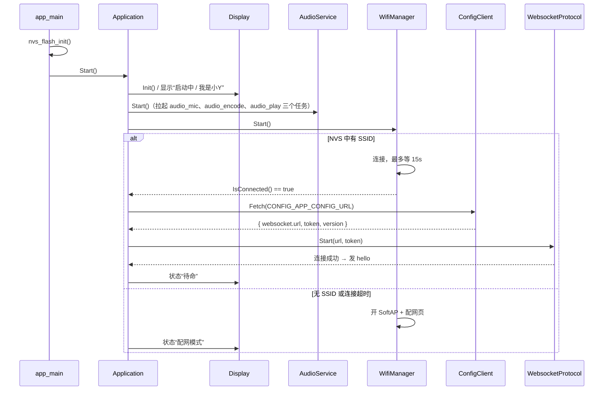
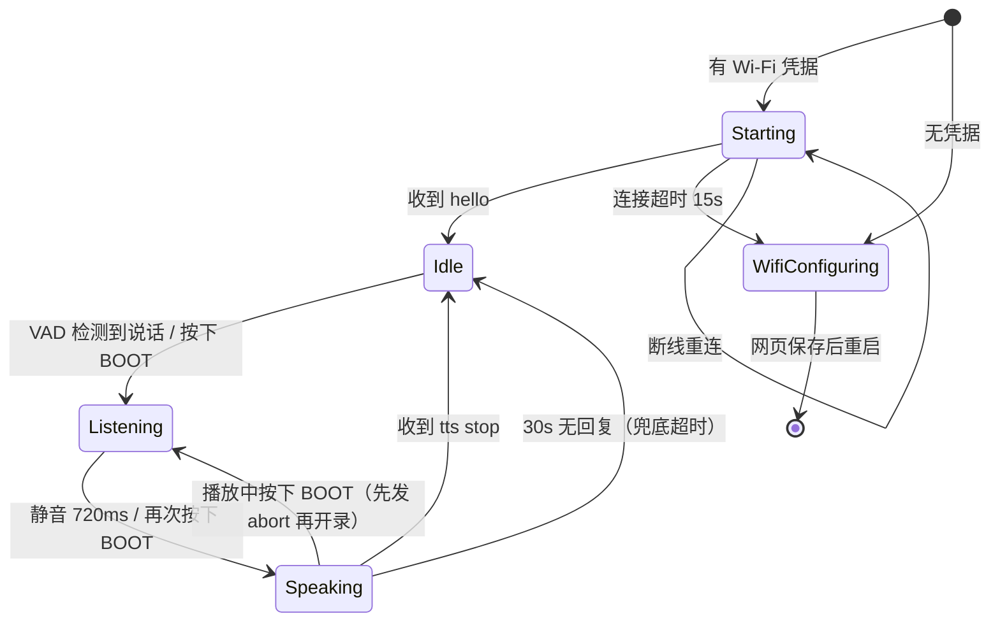
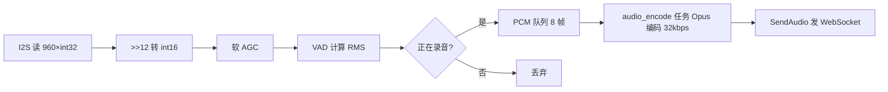
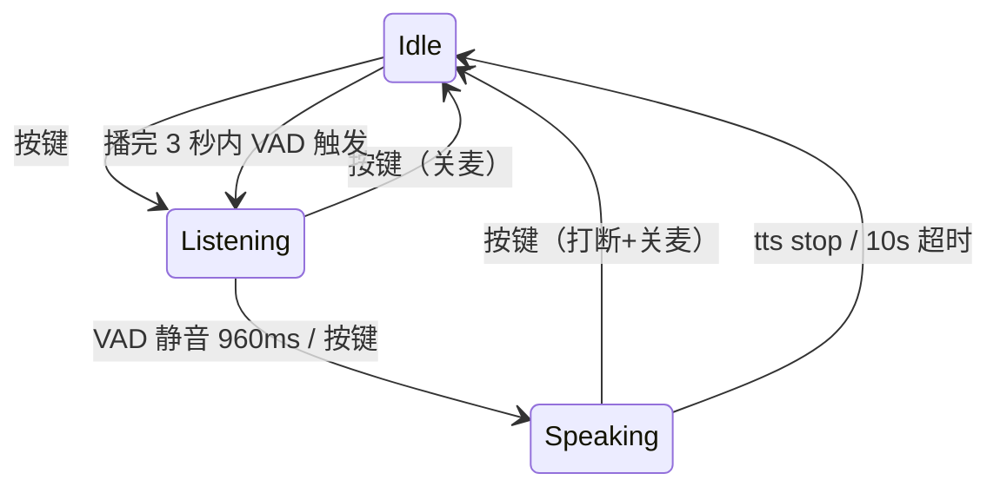
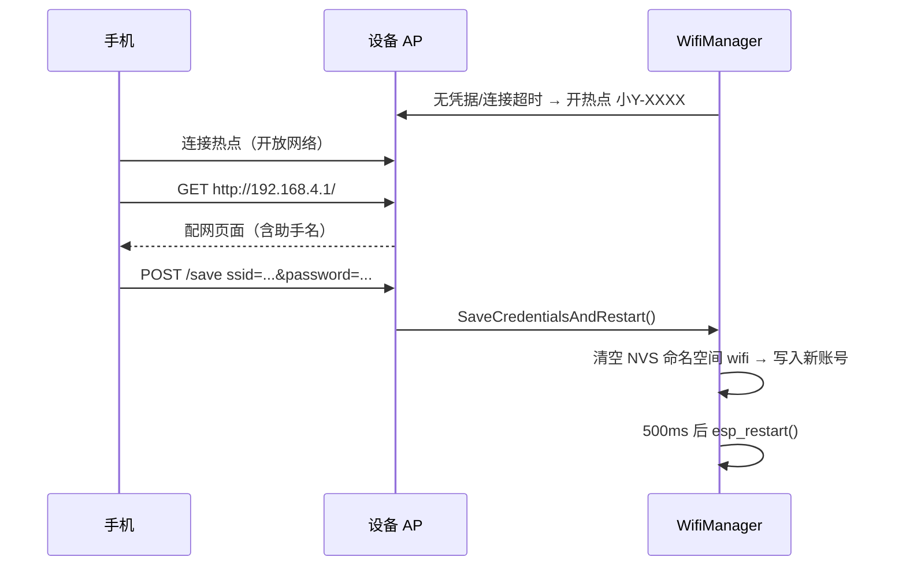

# 固件设计说明

> 版本：0.1.0 ｜ 目标芯片：ESP32-S3（N16R8）｜ 框架：ESP-IDF v6.1

这份文档描述固件的整体结构、模块职责、关键常量与运行时序，目的是让你在改代码前能先建立全局图景。阅读顺序建议：先看第 4、5 节（启动与状态机），再按第 14 节的“代码导读”逐模块进入。

---

## 1. 定位与边界

设备端只做四件事：

1. 连 Wi-Fi（首次通过手机配网）
2. 采集麦克风音频，按 60ms 一帧编码成 Opus 上传
3. 接收服务器下发的 Opus 音频并播放
4. 用一块 128×32 的 OLED 显示状态和对话文本

**明确不做**：OTA 升级、多款开发板适配、离线唤醒词、MCP/IoT 控制、蓝牙配网、摄像头。配置地址与服务器地址在编译期确定（见第 12 节）。

---

## 2. 硬件与接线

| 功能 | GPIO | 说明 |
| --- | --- | --- |
| 麦克风 WS | 4 | INMP441，I2S1 |
| 麦克风 SCK | 5 | INMP441，I2S1 |
| 麦克风 DIN | 6 | INMP441 数据输入 |
| 功放 BCLK | 15 | MAX98357，I2S0 |
| 功放 LRCK | 16 | MAX98357，I2S0 |
| 功放 DOUT | 7 | MAX98357 数据输出 |
| OLED SDA | 41 | SSD1306，I2C 地址 0x3C |
| OLED SCL | 42 | 400kHz |
| BOOT 键 | 0 | 低电平有效 |
| 状态灯 | 48 | 预留 |

所有引脚定义集中在 `main/config.h`，改硬件只改这一个文件。

**为什么麦克风和功放各用一个 I2S 控制器**：这套板子的功放 BCLK/LRCK 接在 GPIO15/16，和麦克风的 GPIO5/4 是两套独立时钟。如果强行用单控制器全双工（TX/RX 共用 BCLK/WS），功放那两根时钟线根本收不到信号，表现就是「一切正常但没有声音」。所以固件开两个通道：I2S0 只发（GPIO15/16/7），I2S1 只收（GPIO5/4/6）。副作用是两边采样率可以不同，也省掉了软件重采样。

---

## 3. 目录结构

```
main/
├── main.cc                  入口：NVS 初始化 → Application::Start()
├── application.cc/.h        状态机、按键、消息分发（唯一的“大脑”）
├── config.h                 引脚与采样率常量
├── Kconfig.projbuild        menuconfig 配置项
├── board/                   板级初始化（目前只有按键 GPIO）
├── audio/
│   ├── audio_io.cc/.h       I2S 收发（两个控制器）、32bit↔16bit 转换、音量
│   ├── audio_service.cc/.h  采集/编码/播放任务、上行下行队列、静音控制
│   ├── opus_codec.cc/.h     Opus 编码器/解码器封装
│   └── vad.cc/.h            能量 VAD
├── display/
│   ├── display.cc/.h        SSD1306 驱动、文本绘制、滚动
│   ├── font_zh16.c          字库点阵（7446 字形，由脚本生成）
│   └── font_glyphs.h        字库符号声明
├── protocol/
│   ├── protocol.cc/.h       协议基类 + listen/abort 等 JSON 构造
│   └── websocket_protocol.* WebSocket 实现、hello、分片重组
├── config/
│   └── config_client.*      HTTP 拉取服务器配置
├── wifi/
│   ├── wifi_manager.*       STA 连接、超时转 AP
│   └── wifi_config_portal.* 配网 HTTP 服务
└── system/
    └── settings.*           NVS 键值读写
```

---

## 4. 启动流程

`app_main()` 只做两件事：初始化 NVS，然后把控制权交给 `Application::Start()`。



要点：

- `AudioService::Start()` 在联网前就执行，麦克风从开机起一直在跑，VAD 也一直在算，只是没联网时不会发包。
- 配置拉取失败不会卡死主循环：`TryConnect()` 返回失败后 5s 重试，期间按键和滚动照常工作。
- WebSocket 断线由 `esp_websocket_client` 自动重连（间隔 3s）；`OnConnectionChanged(false)` 会把状态拉回 `kDeviceStateStarting` 并清空播放队列。

---

## 5. 状态机

状态定义在 `application.h`：

| 状态 | 含义 |
| --- | --- |
| `kDeviceStateStarting` | 启动 / 断线重连中 |
| `kDeviceStateWifiConfiguring` | 处于配网 AP 模式 |
| `kDeviceStateIdle` | 已连接，等待说话 |
| `kDeviceStateListening` | 正在上传音频 |
| `kDeviceStateSpeaking` | 已停止上传，等待或正在播放回复 |

> 注意：`kDeviceStateSpeaking` 同时覆盖“等服务器回复（思考中）”和“播放语音（说话中）”两段，因为固件不区分这两者的内部处理。屏幕文案由 `HandleJson()` 与 `EndListening()` 分别设置。



触发入口只有三个：

1. **VAD 边沿**：`AudioService` 投递 `kVadStart/kVadEnd` 事件 → 主循环 `WaitEvent()` → `Application::HandleVadChanged`
2. **按键**：主循环每 50ms 调 `HandleButton()`，检测 BOOT 的下降沿；同时调 `HandleVolumeKeys()` 处理两个音量键
3. **服务器消息**：`HandleJson()` 处理 `hello` / `tts` / `stt` / `llm`

按 BOOT 开麦后 `manual_listen_ = true`，它只影响 `listen` 消息里的 `mode`；是否结束这一轮仍由 VAD 的“静音 960ms”决定，不需要再按一次。自动开麦只在回复播完后的 3 秒窗口内允许，详见 8.3。

---

## 6. 网络层

### 6.1 配置拉取

`ConfigClient::Fetch(url)` 发一个 **POST**（超时 8s），body 为 `{"application":{"version":"0.1.0"}}`，`Content-Type: application/json`。期望返回：

```json
{
  "websocket": {
    "url": "ws://192.168.31.62:8003/esp32Agent/ws/",
    "token": "",
    "version": 1
  }
}
```

只读取 `websocket.url`、`websocket.token`、`websocket.version` 三个字段，其余忽略。`version` 目前恒为 1，固件也只实现了 v1 二进制帧。

地址来自 `CONFIG_APP_CONFIG_URL`，默认 `http://192.168.31.62:8003/esp32Agent/local/`，在 menuconfig 里可改。

> 服务端同一路径的 `GET` 是健康检查（返回纯文本），只有 `POST` 返回 JSON。固件必须用 POST，否则会解析失败。

### 6.2 建立连接

`WebsocketProtocol::Start()` 用 `esp_websocket_client` 建连，请求头：

```
Device-Id: <12 位 MAC>
Client-Id: <同 MAC>
Protocol-Version: 1
Authorization: Bearer <token>   // token 为空时不带
```

参数：接收缓冲 4096 字节、任务栈 8KB、网络超时 10s、断线 3s 后自动重连。

### 6.3 握手

连接成功后立刻发 `hello`：

```json
{
  "type": "hello",
  "version": 1,
  "transport": "websocket",
  "features": { "mcp": false, "aec": false },
  "audio_params": {
    "format": "opus",
    "sample_rate": 16000,
    "channels": 1,
    "frame_duration": 60
  }
}
```

服务器必须在 10s 内回应，否则会被服务端断开。`hello` 里的 `audio_params` 描述的是**上行**音频参数；下行采样率由服务器决定，本工程后端固定 16kHz，固件按 16kHz 解码并播放。

### 6.4 消息一览

| 方向 | 消息 | 关键字段 |
| --- | --- | --- |
| 设备→服务器 | `hello` | 见上 |
| 设备→服务器 | `listen` | `state: "start"\|"stop"`，`mode: "auto"\|"manual"` |
| 设备→服务器 | `abort` | `reason: "user_interrupt"` |
| 服务器→设备 | `hello` | `transport`、`audio_params` |
| 服务器→设备 | `stt` | `text`：识别结果，上屏 |
| 服务器→设备 | `llm` | `text`、`emotion`：回复文本，上屏 |
| 服务器→设备 | `tts` | `state: "start"\|"stop"`，控制静音与状态 |
| 服务器→设备 | 二进制帧 | Opus 裸数据 |

固件**只处理上述类型**，未知 `type` 直接忽略，不会报错。

### 6.5 二进制帧格式

v1 协议下二进制帧就是裸 Opus 包，没有头部。若将来切到 v2/v3，需要在 `SendAudio()` 和 `HandleEvent()` 的 `WEBSOCKET_EVENT_DATA` 分支里加/去头部，且 `hello` 的 `version` 要同步改。

### 6.6 分片重组

WebSocket 消息可能被拆成多次 `WEBSOCKET_EVENT_DATA` 回调（`payload_offset` 递增）。`rx_buffer_` 按 offset 累积，收满 `payload_len` 才交给 JSON 解析或音频队列；每次连接成功会清空残留。

---

## 7. 音频链路

### 7.1 采样率为什么这样定

| 环节 | 采样率 | 帧长 | 样本数 |
| --- | --- | --- | --- |
| I2S 采集（麦克风） | 16000 | 60ms | 960 |
| I2S 播放（功放） | 16000 | 60ms | 960 |
| Opus 编码（上行） | 16000 | 60ms | 960 |
| Opus 解码（下行） | 16000 | 60ms | 960 |

收发分离后两个控制器可以各跑各的采样率，但后端 `AudioService.SAMPLE_RATE = 16000` 上下行都用 16k，所以这里全部对齐到 16kHz——不需要任何软件重采样。改采样率必须同时改 `config.h`、`opus_codec.h` 和后端，否则表现为快放/变调。

另：`AudioIo::Write()` 的增益是 16.16 定点——`int16 样本 × gain` 直接放进 `int32` 槽的高 16 位（满量程约 2^31）。**不能再右移 16**，否则幅度只剩 1/65536，功放那边就是完全静音。

### 7.2 上行



- `AudioIo::Read()` 一次读 60ms，转换成 int16 时右移 12 位（INMP441 的 24 位数据在 32 位槽的高位）。
- **采集 / 编码 / 发送三段解耦**：采集任务只做 I2S 读、VAD、AGC 和入队；编码和发包都在 `audio_encode` 任务里。网络变慢时队列满就丢帧，采集不会被阻塞（见第 11 节的栈溢出记录）。
- 未录音时保留最近 8 帧做预录（`pre_roll_`），VAD 一触发先补发再转实时，避免切掉第一个音节（见 8.1 节）。

### 7.3 下行


- 解码放在播放任务里，不占用 WebSocket 回调任务。
- **下行是 16kHz**：后端 `AudioService.SAMPLE_RATE = 16000`，TTS 的 Opus 按 16k 编码。功放通道也跑 16k，所以解码完直接写 I2S，不需要重采样。若哪天后端改成 24k，就要同步改 `config.h` 的 `AUDIO_OUTPUT_SAMPLE_RATE` 和 `opus_codec.h` 的 `kSampleRate`，否则会快放/变调。
- 队列满时丢弃新包并打日志，避免内存无限增长。
- 收到 `tts stop` 不会立刻解除静音：若队列里还有音频，等 `kPlaybackFinished` 事件回来再开麦，避免喇叭余音触发 VAD。
- 只有 `abort`（按键打断）才 `ClearPlayback()`。

### 7.4 半双工策略

没有 AEC，播放期间必须闭麦：

- 收到 `tts start` → `AudioService::SetMuted(true)`，采集任务跳过 VAD 和编码
- 收到 `tts stop` → 队列播完后 `SetMuted(false)` 并 `ResetVad()`
- 按键 → `ClearPlayback()` + 发 `abort` + 关麦停在待命（见 8.3）

---

## 8. VAD 算法

实现在 `vad.cc`，按 60ms 帧计算 RMS：

```
rms = sqrt(mean(x²))
threshold = max(400, noise_floor × 3)
```

- **噪声底自适应**：只在“未说话且 rms < 阈值”时更新，`noise_floor = 0.98×noise_floor + 0.02×rms`，避免把说话声吸进噪声底。
- **起始**：连续 2 帧超阈值（120ms）才算开口，抑制爆音。
- **结束（滞回）**：连续 16 帧低于 `0.6 × 阈值`（960ms）才算说完。介于 0.6 倍和 1 倍阈值之间的帧只“拖住”计时，不累加也不清零，句中轻微的音量起伏不会提前断句。
- **两级兜底断句**：连续 8 帧（480ms）低于**绝对静音** 220 也算说完；单句超过 250 帧（15s）强制结束。前者防止噪声底被抬高后永远断不了句，后者防止麦克风被持续噪声锁在“说话中”导致一直开麦。

> 这里踩过一个坑：早期版本把 AGC 之后的帧喂给 VAD，安静帧被放大到接近目标 RMS，噪声底跟着虚高，结果 `speaking_` 再也回不到 false，设备一直处于聆听、后端不停收到空段。现在 `MicTask()` 是「原始帧跑 VAD → 再对上行副本做 AGC」，顺序不能反。

两级阈值的意义：起始用高阈值防误触发，结束用低阈值防漏切。相比单阈值，滞回能明显减少「一句话被切成两三段」，而识别准确率对切句质量非常敏感。

可调参数在 `vad.h` 的 `kStartFrames` / `kEndFrames` / `kMinThreshold` / `kAbsSilence`。环境嘈杂时优先调 `kMinThreshold`，说话被截断则调大 `kEndFrames`。

### 8.1 为识别率做的两处补偿

设备端 VAD 是「先判定、后开录」，天然会晚 120ms 才开始发音频，句子开头容易被吃掉。所以采集侧加了两件事：

| 机制 | 位置 | 作用 |
| --- | --- | --- |
| 预录缓冲 | `MicTask()` 的 `pre_roll_` | 未录音时始终保留最近 8 帧（480ms），`capture_enabled_` 一变真就先把它们补发出去 |
| 软 AGC | `ApplyAgc()` | 按 60ms 帧算 RMS，慢速逼近目标 3000，最多放大 6 倍，只作用于上行 PCM，不影响 VAD 判定 |

注意 AGC 只改「发给服务器的副本」，`vad_.Process()` 用的仍是原始帧，否则噪声底会被增益带跑（这是第 8 节踩坑的根因）。

### 8.2 为什么没有接 ESP-SR AFE

试过 `espressif/esp-sr 2.6.1` 的 AFE，结论是不用，原因记录在此避免重复踩坑：

1. NS（降噪）在没有 `model` 分区时初始化失败——日志是 `E AFE: Failed to initialize NS model 'WEBRTC'`，实例进入坏状态，`feed()` 从此恒返回错误码 320/1024。
2. esp-sr 在配置阶段自己就打印「Noise Supression may reduce the accuracy of speech recognition. It is not recommended to turn it on.」，即官方不建议为 ASR 开 NS。
3. 关掉 NS 只留 AGC + VAD 后，`feed` 依然返回 320（该版本 AFE 需要模型分区配合，且 feed/fetch 帧长不等——`feed 160 / fetch 512`，内部环形缓冲极易被塞满）。
4. 去掉 NS 和 AEC 后，AFE 只剩 AGC + VAD，而这两项本工程已有等价实现（8.1 的软 AGC + 第 8 节的滞回 VAD）。

因此固件不依赖 esp-sr，二进制也小约 600KB。若将来确实需要降噪，正确做法是引入 `esp-srmodels` 组件、划分 `model` 分区并烧写模型，而不是只加一个 AFE 头文件。

### 8.3 开麦策略：按键为主，回复后 3 秒续聊

早期版本在 `kDeviceStateIdle` 下**一直**允许 VAD 触发 `BeginListening(false)`，结果出现「停止聆听后过一会儿又自己开始聆听」：

1. 采集任务里 `Deliver()` 是先跑 VAD、先 `PostEvent()`，**再**判断 `capture_enabled_`，所以待命时 VAD 事件照常上报；
2. `tts stop` 或 10 秒兜底超时会把状态拉回 `kDeviceStateIdle` 并 `SetMuted(false)`，麦克风重新进入可触发状态；
3. 于是待命时任何 120ms 以上的噪声（环境声、关门、喇叭余音）都会重新开麦。

现在改成两段式（`application.h` 的 `continue_until_` / `resume_cooldown_until_`）：

| 时机 | 行为 |
| --- | --- |
| 按键（任意状态） | 开麦/关麦的开关：聆听中→关麦；说话中→打断+关麦；待命中→开麦 |
| 回复播完 | 打开 3 秒续聊窗口，窗口内 VAD 可自动进入下一轮 |
| 窗口过期 | 不再自动开麦，必须按键 |
| 播完后 600ms 内 | 忽略 VAD，避免喇叭余音把自己唤醒 |



要点：`EndListening()` 和按键关麦都会把窗口清零，所以“主动结束”之后不会再被自动唤醒；只有正常播完回复，才给 3 秒的免按键机会。窗口时长是 `application.cc` 顶部的 `kContinueWindowUs`，设 0 即完全手动，设很大即回到早期“随时可唤醒”。

还有一层兜底：`Start()` 主循环里，若状态停在 `kDeviceStateListening` 超过 20 秒仍未收到 `kVadEnd`，直接 `EndListening()` 并打印 `Listening timeout, stop`。这条只会在 VAD 异常时触发，用来保证“麦克风不会一直开着”。

### 8.4 音量按键

`config.h` 里的 `VOLUME_UP_BUTTON_GPIO`（GPIO40）和 `VOLUME_DOWN_BUTTON_GPIO`（GPIO39）在 `Board::Init()` 里按上拉输入初始化，主循环每轮调 `HandleVolumeKeys()`：

- 按下沿触发，单步 ±10，范围 10~100；
- 通过 `AudioIo::SetVolume()` 的 16.16 定点增益生效（平方曲线，听感更线性）；
- 写 NVS `app/volume`，重启后恢复；
- OLED 第二行临时显示「音量 N」，日志打印 `Volume -> N`。

> 早期固件只初始化了 BOOT 键（GPIO0），另外两个按键根本没配 GPIO，所以按了没反应。

---

## 9. 显示子系统

### 9.1 硬件驱动

`display.cc` 直接用 `i2c_master` 写 SSD1306，没有用 LVGL。

- 初始化序列：关显示 → 设 multiplex=32 → 开电荷泵 → 水平寻址 → 段重映射 → 开显示。
- 帧缓冲 `framebuffer_[4][128]`，4 页 × 128 列，每字节 8 个垂直像素，bit0 在上。
- `Flush()` 逐页写：先发 `0xB0|page, 0x00, 0x10` 定位，再发 128 字节数据（控制字节 0x40）。

### 9.2 字库格式

`font_zh16.c` 由 `tools/gen_font.py` 生成（Pillow + 黑体），内容：

| 表 | 尺寸 | 格式 |
| --- | --- | --- |
| `kAsciiFont[95][16]` | 8×16 | 每列 1 字节 × 2 页 |
| `kHanziFont[7446][32]` | 16×16 | 每列 2 字节（上页、下页） |
| `kHanziCodepoints[7446]` | — | 升序 Unicode，供二分查找 |

字符集是 **GB2312 全集**（6763 汉字 + 符号）外加常用中文标点。不在字库里的字会画成空白，但不会崩。

重新生成字库（改字体/字号/加字时）：

```bash
python tools/gen_font.py            # 需要 Pillow 与 C:\Windows\Fonts\simhei.ttf
python tools/gen_font.py 其它字体.ttf
```

> 字库文件 1.2MB 源码、约 238KB 固件体积，换字体注意分区余量（当前还剩 64%）。

### 9.3 绘制与滚动

- 第一行固定显示状态（`SetStatus`），第二行显示消息（`SetMessage`）。
- `MeasureWidth()` 按 8px/ASCII、16px/汉字累加像素宽度。
- 超过 128px 时进入滚动：先停 600ms（`kScrollPause` 个 50ms tick），然后每次 `Tick()` 左移 1px，滚过 `宽度+16` 后回到起点。
- `DrawText()` 支持负 x，逐列判断 `0 ≤ column < 128` 才写入，所以滚动时不会越界。
- `Tick()` 由主循环每 50ms 调一次，没有独立定时器。

---

## 10. 配网



- 热点名：`<CONFIG_APP_AP_SSID_PREFIX>-<MAC 后两字节>`，默认 `XiaoY-XXXX`。用纯英文前缀，避免部分手机对中文 SSID 兼容性不好。
- 配网页由 `wifi_config_portal.cc` 内嵌（约 60 行 HTML），表单 `application/x-www-form-urlencoded`，`+` 与 `%XX` 都会解码。
- NVS 键：命名空间 `wifi`，键 `ssid` / `password`。
- AP 的 `esp_netif` 必须在 `esp_wifi_start()` 之前创建，否则设备拿不到 192.168.4.1。
- STA 连上后会调 `esp_wifi_set_ps(WIFI_PS_NONE)`：关掉 modem sleep，否则下行音频会被 DTIM 休眠拖出周期性卡顿。代价是功耗略高，这个设备一直插电，无所谓。
- 配网成功后设备重启，走正常 STA 流程。

---

## 11. 任务与并发

| 任务 | 栈 | 优先级 | 职责 |
| --- | --- | --- | --- |
| `audio_mic` | 6144 | 8 | I2S 读、软 AGC、VAD、投 VAD 事件、PCM 入队 |
| `audio_encode` | 40960 | 5 | 取 PCM、Opus 编码、`SendAudio()` 发 WebSocket |
| `audio_play` | 24576 | 6 | 队列取包、Opus 解码、I2S 写 |
| `wifi_timeout` | 3072 | 5 | 15s 后仍没连上就切 AP |
| `wifi_retry` | 2048 | 5 | 断线 2s 后重连 |
| `esp_websocket` 内部任务 | 8192 | 默认 | 收包、解析 JSON、触发事件回调 |
| 主任务（`app_main` 上下文） | 16384 | 1 | 按键扫描、显示 Tick、状态推进、消费音频事件、配置拉取 |

**为什么编码和播放要单独占大栈**：`esp_audio_codec` 官方说明写得很清楚——「为了支持所有编码器，运行栈约需 40KB」「解码器所在任务栈约需 20KB」。60ms 帧（960 点）下 `esp_opus_enc_process` 会在任务栈上开十几 KB 的临时数组。实测放在 10KB 的采集任务里必然撞栈，放到 24KB 仍然不够（`A stack overflow in task audio_encode`），最终定为编码 40KB、播放 24KB。采集任务则只管搬运 PCM。

**为什么 VAD 事件要跨任务投递**：VAD 在采集任务里算出来，但「开始聆听」要发 `listen` 消息、要刷 OLED、要调 `esp_websocket_client_send_text`，这些都是深层调用链。直接在采集任务里调回调等于把整条链压在 6KB 栈上，所以改成 `PostEvent()` 入队、主任务 `WaitEvent()` 消费。

**历史事故 1（已修）**：最初把「编码 + 发送」放在同一个 4096 字节的采集任务里，`SendAudio` 走到 `esp_websocket_client → lwip → select`，栈溢出后踩坏堆，表现为随机的 `LoadProhibited`、`task_wdt: task not found` 和 `__cxa_guard_acquire` 断言。

**历史事故 2（已修）**：拆出发送任务后，采集任务仍要自己做 Opus 编码、还要在 VAD 回调里切状态，10240 字节仍不够，表现为连上服务器后 3~10 秒必崩、串口打印 `A stack overflow in task audio_mic`。现在的划分见上表。

并发要点：

- `AudioService` 的开关状态（`capture_enabled_`、`muted_`、`playing_`）都是 `std::atomic<bool>`，跨任务读写不需要加锁。
- 上行 `pcm_queue_` 元素是 `std::vector<int16_t>*`（8 帧，约 15KB），下行 `packet_queue_` 元素是 `std::vector<uint8_t>*`；队列满时丢弃并 `delete`，保证不泄漏也不阻塞。
- 音频事件 `event_queue_` 长度 8，元素是 1 字节枚举；事件只是状态提示，丢了不影响音频流。
- `WebsocketProtocol::SendAudio/SendJson` 用 `send_mutex_` 串行化，因为编码任务和主任务都可能发包。
- 播放队列的清理由 `ClearPlayback()` 负责，逐个 `delete` 残留元素。
- 显示用 `Display::mutex_` 串行化：主任务（`Tick()` 滚动）和 WebSocket 回调（`SetStatus/SetMessage`）都会刷 I2C，不能靠驱动内部互斥，否则会出现半帧撕裂。

---

## 12. 配置项

`idf.py menuconfig` → `Application Configuration`：

| 配置 | 默认值 | 作用 |
| --- | --- | --- |
| `APP_ASSISTANT_NAME` | `小Y` | 显示名、配网页标题 |
| `APP_AP_SSID_PREFIX` | `XiaoY` | 配网热点前缀 |
| `APP_CONFIG_URL` | `http://192.168.31.62:8003/esp32Agent/local/` | 启动时拉配置的地址 |

> 改 `APP_ASSISTANT_NAME` 只影响显示与配网页；如果名字里有生僻字，记得重新生成字库。
> `sdkconfig` 是生成文件（已在 `.gitignore` 中），改完 Kconfig 默认值后要删掉它重新构建，否则会继续沿用旧值。

`sdkconfig.defaults` 里的关键项（影响启动成败）：

```
CONFIG_ESPTOOLPY_FLASHSIZE_16MB=y
CONFIG_SPIRAM=y / CONFIG_SPIRAM_MODE_OCT=y / 80MHz
CONFIG_ESP_DEFAULT_CPU_FREQ_MHZ_240=y
CONFIG_ESP_MAIN_TASK_STACK_SIZE=16384
CONFIG_PARTITION_TABLE_CUSTOM=y → partitions.csv
```

---

## 13. 分区与体积

`partitions.csv`：

| 分区 | 类型 | 偏移 | 大小 |
| --- | --- | --- | --- |
| nvs | data/nvs | 0x9000 | 16KB |
| phy_init | data/phy | 0xD000 | 4KB |
| factory | app | 0x10000 | 4MB |
| storage | data/spiffs | 0x410000 | 1MB |

当前固件约 1.49MB，app 分区剩余 64%。没有 OTA 分区，升级只能重新烧录。

---

## 14. 代码导读

建议按这个顺序读：

1. **`main.cc`（16 行）**：看入口做了什么。
2. **`application.h`**：先记住五个状态和成员变量，再看 `application.cc`。
3. **`application.cc`**：
   - `Start()`：初始化顺序 + 主循环（按键、显示、联网重试、超时兜底）
   - `TryConnect()`：配置拉取与协议实例化
   - `HandleJson()`：服务器消息如何影响状态
   - `HandleVadChanged()` / `BeginListening()` / `EndListening()`：录音的开关（由主循环消费事件触发）
   - `HandlePlaybackFinished()` / `OpenContinueWindow()`：播完解除静音并开 3 秒续聊窗口
   - `HandleButton()`：按键的开麦/关麦语义（见 8.3）
4. **`protocol/websocket_protocol.cc`**：`Start()` → `SendHello()` → `HandleEvent()`，注意分片重组。
5. **`audio/audio_service.cc`**：`MicTask()`、`EncodeTask()`、`PlayTask()` 三个循环，配合 `audio_io.cc` 看 I2S 细节。注意上行是「采集入队 → 编码任务编码发送」，编码 40KB、解码 24KB 的栈不是随手写的，别把编解码并回采集任务。
6. **`audio/vad.cc`**：只有 40 行，公式见第 8 节。
7. **`display/display.cc`**：`DrawText()` → `DrawAscii/DrawHanzi` → `Flush()`，滚动只在 `Tick()`。
8. **`wifi/`**：`Start()` 的分支逻辑，以及 `wifi_config_portal.cc` 的两个 handler。
9. **`config/config_client.cc`**、**`system/settings.cc`**：外围工具，用时再查。

每个模块的“为什么”都在本文章节里有对应说明，可以对照阅读。

---

## 15. 常见改动

| 想做的事 | 改哪里 | 注意 |
| --- | --- | --- |
| 换引脚 | `config.h` | 麦克风三个脚归 I2S1，功放三个脚归 I2S0，别混用 |
| 换服务器地址 | menuconfig `APP_CONFIG_URL` | 改完需重编译 |
| 改帧长（如 20ms） | `opus_codec.h` 的 `kFrameDurationMs` + 后端 | 两端必须一致，否则声音变速 |
| 改音量 | 音量键 GPIO39/40，或 `AudioIo::SetVolume(0-100)` | 默认 80，存在 NVS `app/volume` |
| 加新消息类型 | `HandleJson()` 加分支 | 未识别类型会被忽略，安全 |
| 加字库字符 | `tools/gen_font.py` 的 `chars.update(...)` | 重新生成后编译 |
| 关掉续聊窗口，只留按键 | `application.cc` 的 `kContinueWindowUs` 改 0 | 按键开关逻辑见 8.3 |

---

## 16. 排障

| 现象 | 首查 |
| --- | --- |
| 开机进配网模式 | NVS 里没有 `wifi/ssid`，或 15s 内没连上 |
| 屏幕停在“连接中” | `APP_CONFIG_URL` 不通，或返回 JSON 缺 `websocket.url` |
| 连上但马上断开 | 服务端要求 10s 内 `hello`；看日志有没有 “Hello sent” |
| 没有声音 | 先看 `tts start` 是否收到；再确认功放 BCLK/LRCK 接在 GPIO15/16（不是共用的 5/4）；最后查 `AudioIo::Write` 的增益是否有右移 16 |
| 说话没反应 | VAD 阈值过高；把 `kMinThreshold` 调小，或直接按 BOOT 手动录音 |
| 一直重复触发 | 环境噪声大，噪声底被抬高；适当提高 `kMinThreshold` |
| 屏幕花屏/不亮 | I2C 地址不是 0x3C，或 SDA/SCL 接反 |

日志关键字：`Application`、`WifiManager`、`ConfigClient`、`Websocket`、`AudioService`、`Display`。VAD 没有独立日志，通过 Application 的状态日志观察。

---

## 17. 已知限制

- 没有 AEC，播放与录音互斥，不能边听边说。
- 断线由底层自动重连，每次 `CONNECTED` 事件都会重发 `hello`；如果服务端要求新 session，需要自行扩展。
- 显示只支持 GB2312 字符，emoji、繁体、生僻字显示为空白。
- 没有 OTA，升级靠 USB。
- 上下行音频都固定 16kHz，服务器改采样率需同步改 `config.h` 与 `opus_codec.h`。
- 单设备单会话，不做多用户隔离。

---

## 18. 与后端的契约

后端需要满足：

1. `POST /esp32Agent/local/`（或配置的地址）返回 `websocket.url` / `token` / `version`
2. WebSocket 端点在 10s 内回应 `hello`
3. 下行 Opus 为 16kHz、单声道、60ms 帧
4. 回复文本通过 `stt` / `llm` 的 `text` 字段下发
5. 用 `tts start/stop` 控制设备静音状态
6. 支持 `abort` 后立即停止下发 TTS

设备侧对未知字段和未知消息类型都做了兼容，后端可以逐步扩展。
